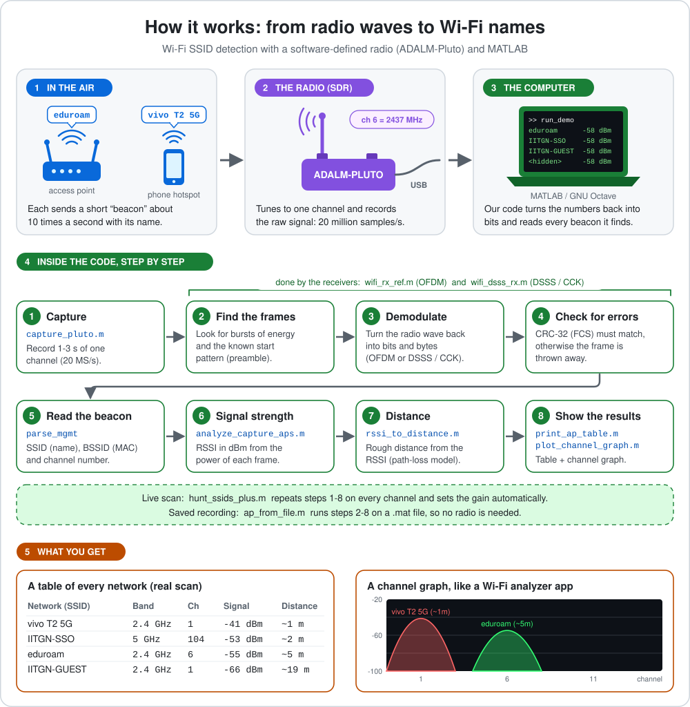
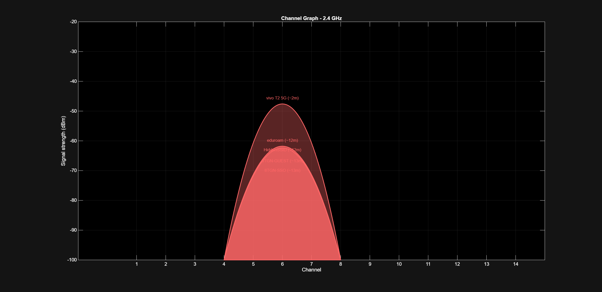
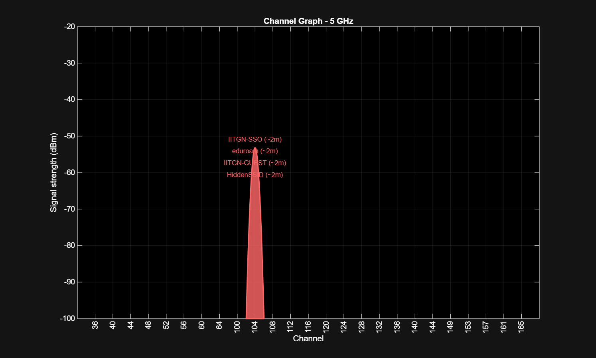
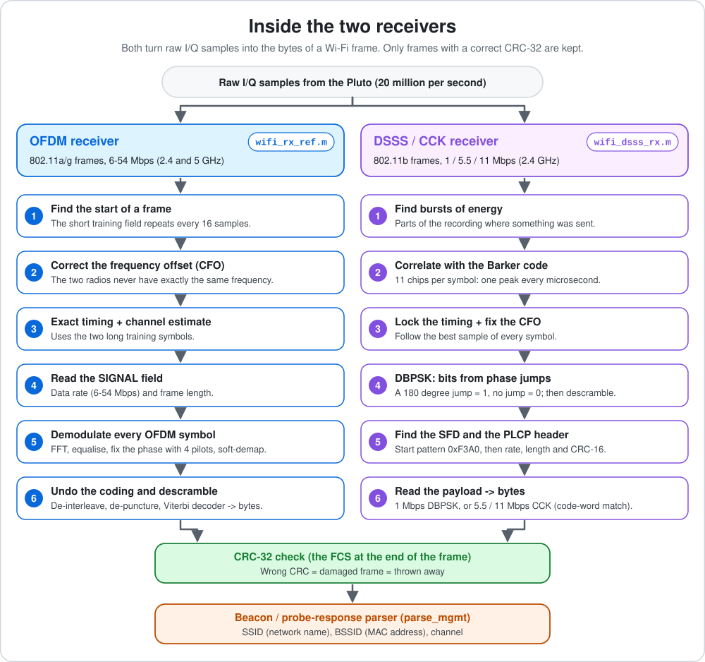
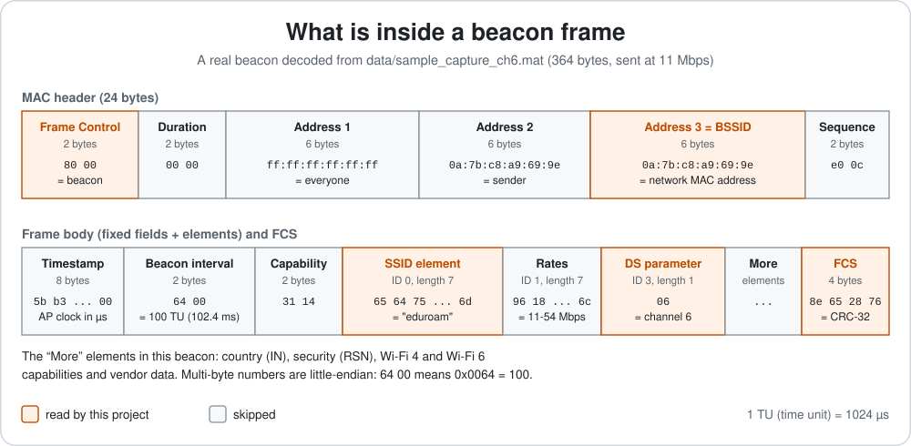
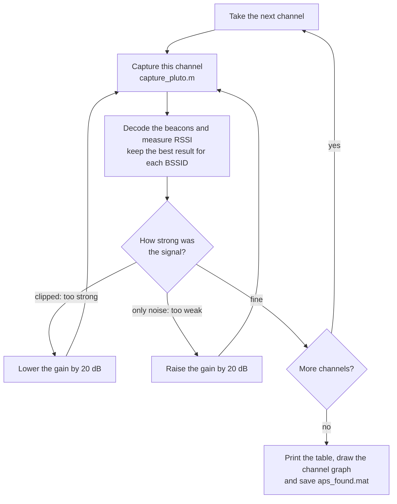
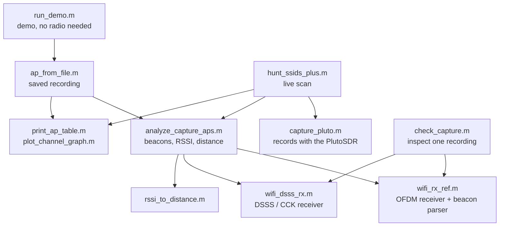

# Wi-Fi SSID Detection using SDR

**Detect all the Wi-Fi names around you using SDR.**

This project finds the names (SSIDs) of the Wi-Fi networks around you with a low-cost
**software-defined radio** (ADALM-Pluto) and **MATLAB**. It does not use a Wi-Fi card or a Wi-Fi
library. It records the raw radio signal and decodes it with its own receiver code, step by step,
until the network names come out.

<p align="center">
  
</p>

**In short:** the Pluto records one Wi-Fi channel, our receivers turn the radio signal back into bytes,
and every error-free beacon tells us a network's **name (SSID)**, its **MAC address (BSSID)**, its
**channel**, its **signal strength** and a **rough distance**.

---

## Contents

1. [What this project does](#what-this-project-does)
2. [Results](#results)
3. [Try it in 1 minute (no radio needed)](#try-it-in-1-minute-no-radio-needed)
4. [How it works](#how-it-works)
5. [Live scan with the PlutoSDR](#live-scan-with-the-plutosdr)
6. [Calibrate the signal strength](#calibrate-the-signal-strength)
7. [Settings (ap_config.m)](#settings-ap_configm)
8. [Files in this repository](#files-in-this-repository)
9. [How we know it works](#how-we-know-it-works)
10. [Troubleshooting](#troubleshooting)
11. [Limits](#limits)
12. [Glossary (easy words)](#glossary-easy-words)
13. [Credits](#credits)

---

## What this project does

Every Wi-Fi access point (a router or a phone hotspot) keeps announcing itself. About **10 times every
second** it sends a short message called a **beacon**. The beacon says, for example:
*"My name is eduroam, my address is 0a:7b:c8:a9:69:9e, I am on channel 6."*
Your phone listens to these beacons to build its list of Wi-Fi networks.

This project does the same job **by hand**:

1. **Record:** the ADALM-Pluto radio tunes to one Wi-Fi channel and records the raw signal
   (20 million samples per second).
2. **Decode:** two receivers written in MATLAB turn the signal back into bits and bytes:
   - an **OFDM receiver** for 802.11a/g frames (all legacy rates, 6 to 54 Mbps), and
   - a **DSSS / CCK receiver** for 802.11b frames (1, 5.5 and 11 Mbps).
3. **Check:** only frames with a correct **CRC-32** checksum are kept.
4. **Read:** from every beacon we read the **SSID**, the **BSSID** and the **channel**.
5. **Measure:** we measure the **signal strength (RSSI, in dBm)** and estimate the **distance**.
6. **Show:** a table of all networks and a **channel graph**, like a Wi-Fi analyzer app on a phone.

Main features:

- 2.4 GHz band (channels 1 to 13) and 5 GHz band (channels 36 to 165, needs the Pluto's extended tuning
  range, see [step 2 of the live scan](#steps)).
- **Automatic gain** for every channel, so strong and weak networks are both handled.
- Works on **saved recordings** too, so you can try everything without any hardware.
- The receivers use **base MATLAB only** (no toolbox). Everything except the live capture also runs in the
  free **GNU Octave**.
- **Self-tests** with real recorded Wi-Fi frames show that the receivers decode correctly.

---

## Results

### Channel graphs from real scans

Each hill is one network. Its position is the channel, its height is the signal strength (higher = stronger)
and the label shows the network name and the rough distance.

**2.4 GHz, channel 6:** a phone hotspot (`vivo T2 5G`, about 2 m away) and four campus networks.

<p align="center">
  
</p>

**5 GHz, channel 104:** four campus networks, about 2 m away.

<p align="center">
  
</p>

### Table from a real live scan

This is the saved result of a live scan with the Pluto over channels 1, 6 and 104
(file [`data/aps_found.mat`](data/aps_found.mat)). **21 networks** were found.

<details>
<summary><b>Show the full table (21 networks)</b></summary>

| # | SSID | BSSID | Ch | Band | Frames | Gain (dB) | RSSI (dBm) | Distance (m) |
|---:|---|---|---:|---|---:|---:|---:|---:|
| 1 | vivo T2 5G | `26:35:7d:f8:80:9e` | 1 | 2.4 GHz | 36 | 25 | -41.3 | 1.2 |
| 2 | IITGN-SSO | `0e:7b:d8:a9:69:9e` | 104 | 5 GHz | 28 | 25 | -53.1 | 2.0 |
| 3 | eduroam | `0a:7b:d8:a9:69:9e` | 104 | 5 GHz | 29 | 25 | -53.1 | 2.0 |
| 4 | IITGN-GUEST | `06:7b:d8:a9:69:9e` | 104 | 5 GHz | 28 | 25 | -53.2 | 2.0 |
| 5 | &lt;hidden&gt; | `02:7b:d8:a9:69:9e` | 104 | 5 GHz | 28 | 25 | -53.2 | 2.0 |
| 6 | IITGN-SSO | `0c:7b:c8:a9:69:9e` | 6 | 2.4 GHz | 26 | 25 | -54.5 | 5.2 |
| 7 | eduroam | `0a:7b:c8:a9:69:9e` | 6 | 2.4 GHz | 19 | 25 | -54.7 | 5.3 |
| 8 | &lt;hidden&gt; | `02:7b:c8:a9:69:9e` | 6 | 2.4 GHz | 27 | 25 | -54.8 | 5.4 |
| 9 | IITGN-GUEST | `06:7b:c8:a9:69:9e` | 6 | 2.4 GHz | 20 | 25 | -54.9 | 5.4 |
| 10 | IITGN-GUEST | `06:7b:c8:a9:5a:28` | 1 | 2.4 GHz | 19 | 25 | -65.5 | 18.7 |
| 11 | &lt;hidden&gt; | `02:7b:c8:a9:5a:28` | 1 | 2.4 GHz | 22 | 25 | -65.6 | 18.8 |
| 12 | eduroam | `0a:7b:c8:a9:5a:28` | 1 | 2.4 GHz | 21 | 25 | -65.7 | 19.0 |
| 13 | IITGN-SSO | `0c:7b:c8:a9:5a:28` | 1 | 2.4 GHz | 28 | 25 | -65.7 | 19.0 |
| 14 | eduroam | `0a:7b:c8:a9:5c:76` | 1 | 2.4 GHz | 20 | 25 | -75.1 | 56.4 |
| 15 | &lt;hidden&gt; | `02:7b:c8:a9:5c:76` | 1 | 2.4 GHz | 14 | 25 | -75.4 | 58.3 |
| 16 | IITGN-SSO | `0c:7b:c8:a9:5c:76` | 1 | 2.4 GHz | 23 | 25 | -75.4 | 58.4 |
| 17 | IITGN-GUEST | `06:7b:c8:a9:5c:76` | 1 | 2.4 GHz | 13 | 25 | -75.4 | 58.5 |
| 18 | &lt;hidden&gt; | `02:7b:c8:a9:54:ca` | 1 | 2.4 GHz | 17 | 45 | -85.2\* | 180.9 |
| 19 | IITGN-GUEST | `06:7b:c8:a9:54:ca` | 1 | 2.4 GHz | 7 | 45 | -85.3\* | 182.4 |
| 20 | eduroam | `0a:7b:c8:a9:54:ca` | 1 | 2.4 GHz | 17 | 45 | -85.3\* | 182.7 |
| 21 | IITGN-SSO | `0c:7b:c8:a9:54:ca` | 1 | 2.4 GHz | 25 | 45 | -85.4\* | 183.3 |

</details>

How to read it:

- The strongest signal is a **phone hotspot** (`vivo T2 5G`), about 1 m from the radio.
- Each campus access point sends **four network names**: `IITGN-SSO`, `eduroam`, `IITGN-GUEST` and one
  hidden network. They come from the same box, so they have the same signal strength. Each name has its
  own BSSID; the BSSIDs differ only in the first byte.
- `<hidden>` is a network that does not broadcast its name (its SSID field is empty).
- `*` means the radio was overloaded (the signal was **clipped**) during that capture, so that RSSI is not
  reliable.
- **Frames** is the number of error-free beacons used for that row. **Distance** is a rough estimate
  (see [signal strength and distance](#6-signal-strength-rssi-and-distance)).

To show this table and its graphs yourself:

```matlab
addpath('src')
scan = load('data/aps_found.mat');
print_ap_table(scan.aps)
plot_channel_graph(scan.aps, '2.4')
plot_channel_graph(scan.aps, '5')
```

---

## Try it in 1 minute (no radio needed)

1. Get the code: `git clone https://github.com/sinhavikashk/Wifi-SSID-Detection-using-SDR.git`
   (or click **Code > Download ZIP** on GitHub and unzip it; the folder is then called
   `Wifi-SSID-Detection-using-SDR-main`).
2. Open **MATLAB** (or GNU Octave) and go to the folder:
   ```matlab
   cd Wifi-SSID-Detection-using-SDR
   ```
3. Run the demo:
   ```matlab
   run_demo
   ```

`run_demo` does four things (it takes about 10 to 20 seconds):

| Step | What happens | What you should see |
|---|---|---|
| 1 | Self-test of the OFDM receiver on 7 real 802.11a recordings | `TOTAL frames=121  FCS_ok=121` and `SELF-TEST PASSED` |
| 2 | Self-test of the DSSS / CCK receiver on 4 test signals | `DSSS SELF-TEST PASSED` |
| 3 | Finds the networks in a real 0.5 s recording of channel 6 (`data/sample_capture_ch6.mat`) | A table with 4 networks and a channel graph (also saved as `channel_graph_2.4GHz.png`) |
| 4 | Shows the result of the real live scan above (`data/aps_found.mat`) | The 21-row table and two channel graphs |

Part of the output (from GNU Octave 8.4; MATLAB prints the same lines, the last digits and the order of
rows with equal strength can differ slightly):

```text
TOTAL frames=121  FCS_ok=121   (expect 121 / 121)
SELF-TEST PASSED
...
DSSS SELF-TEST PASSED
...
=== Access points found (strongest first) ===
#   SSID                     BSSID              Ch   Band     Frames Gain  RSSI(dBm)  Dist(m)
1   <hidden>                 02:7b:c8:a9:69:9e  6    2.4 GHz  4      25    -58.0      7.7
2   IITGN-SSO                0c:7b:c8:a9:69:9e  6    2.4 GHz  4      25    -58.0      7.8
3   IITGN-GUEST              06:7b:c8:a9:69:9e  6    2.4 GHz  3      25    -58.0      7.8
4   eduroam                  0a:7b:c8:a9:69:9e  6    2.4 GHz  5      25    -58.0      7.8

Total: 4 access point(s).
```

<details>
<summary><b>Show the complete output of steps 1 to 3</b></summary>

```text
========== Step 1: OFDM receiver self-test (802.11a/g) ==========
== unit checks ==
scrambler first 16 bits = 0000111011110010 (expect 0000111011110010)  ok
pilot polarity p0..p7 = [1 1 1 1 -1 -1 -1 1] (expect 1 1 1 1 -1 -1 -1 1)  ok
crc32("123456789") = cbf43926 (expect cbf43926)  ok
nbpsc=1 average power = 1.0000 (expect 1)  ok
nbpsc=2 average power = 1.0000 (expect 1)  ok
nbpsc=4 average power = 1.0000 (expect 1)  ok
nbpsc=6 average power = 1.0000 (expect 1)  ok
interleaver N_CBPS=48 is a permutation  ok
interleaver N_CBPS=96 is a permutation  ok
interleaver N_CBPS=192 is a permutation  ok
interleaver N_CBPS=288 is a permutation  ok
conv-code + Viterbi round trip, rate 1/2: 0 errors / 600  ok
conv-code + Viterbi round trip, rate 2/3: 0 errors / 600  ok
conv-code + Viterbi round trip, rate 3/4: 0 errors / 600  ok

== real-capture decode ==
using test data from: .../src/test_data
dot11a_12mbps_qos_data_e4_90_7e_15_2a_16_e8_de_27_90_6e_42.dat frames=20
dot11a_18mbps_qos_data_e4_90_7e_15_2a_16_e8_de_27_90_6e_42.dat frames=17
dot11a_24mbps_qos_data_e4_90_7e_15_2a_16_e8_de_27_90_6e_42.dat frames=18
   24 Mbps QoS-data, first 24 bytes: 88422c00e4907e152a16e8de27906e42e8de27906e407013
   probe-resp from BSSID e8:de:27:90:6e:42: SSID='AP3-5' channel=40
dot11a_36mbps_qos_data_e4_90_7e_15_2a_16_e8_de_27_90_6e_42.dat frames=15
dot11a_48mbps_qos_data_e4_90_7e_15_2a_16_e8_de_27_90_6e_42.dat frames=17
dot11a_6mbps_qos_data_e4_90_7e_15_2a_16_e8_de_27_90_6e_42.dat frames=17
dot11a_9mbps_qos_data_e4_90_7e_15_2a_16_e8_de_27_90_6e_42.dat frames=17

TOTAL frames=121  FCS_ok=121   (expect 121 / 121)
SELF-TEST PASSED

========== Step 2: DSSS receiver self-test (802.11b) ==========
case 1 (clean, 25 dB): decoded byte-exact
case 2 (CFO +60 kHz, +40 ppm, 12 dB): decoded byte-exact
case 3 (CFO -75 kHz, -55 ppm, 8 dB): decoded byte-exact
case 4 (long SSID, 15 dB, CFO 20 kHz): decoded byte-exact
DSSS SELF-TEST PASSED

========== Step 3: find the Wi-Fi networks in a saved recording ==========
File .../data/sample_capture_ch6.mat: channel 6, 0.5 s

=== Access points found (strongest first) ===
#   SSID                     BSSID              Ch   Band     Frames Gain  RSSI(dBm)  Dist(m)
1   <hidden>                 02:7b:c8:a9:69:9e  6    2.4 GHz  4      25    -58.0      7.7
2   IITGN-SSO                0c:7b:c8:a9:69:9e  6    2.4 GHz  4      25    -58.0      7.8
3   IITGN-GUEST              06:7b:c8:a9:69:9e  6    2.4 GHz  3      25    -58.0      7.8
4   eduroam                  0a:7b:c8:a9:69:9e  6    2.4 GHz  5      25    -58.0      7.8

Total: 4 access point(s).
Distance model: TX 0 dBm assumed, path-loss exponent n = 2, CAL_DB = 0 (ap_config.m).
RSSI / distance are estimates (walls, reflections, unknown AP power): use as rough guide.
Saved graph: channel_graph_2.4GHz.png
```

</details>

---

## How it works

The picture at the top shows the whole chain. Here is every part in simple words.

### 1. Wi-Fi channels and beacons

- Wi-Fi uses **channels**. Each channel is **20 MHz** wide.
  - 2.4 GHz band: channels 1 to 13, centre frequency = **2407 + 5 × channel** MHz (channel 6 = 2437 MHz).
  - 5 GHz band: channels 36 to 165, centre frequency = **5000 + 5 × channel** MHz (channel 36 = 5180 MHz).
  - `wifi_channel_freq.m` does this conversion.
- An access point sends a **beacon every 102.4 ms** (100 "time units") on its channel.
- New routers (Wi-Fi 4, 5 and 6) still send their beacons in the **old, simple formats** (802.11b or
  802.11a/g), so that every device can understand them. That is why two "old" receivers are enough to read
  the beacons of modern routers. In our sample recording the campus beacons are sent at 11 Mbps (802.11b CCK).

### 2. Recording the signal with the SDR

- A **software-defined radio (SDR)** does only the radio part in hardware: it tunes to a frequency and
  turns the wave into numbers. Everything else (demodulation, decoding) is done by our software.
- The Pluto gives **I/Q samples**: two numbers per sample (I = in-phase, Q = quadrature). Think of each
  sample as a small arrow: its **length** is how strong the wave is, its **angle** is the phase.
- We take **20 million samples per second** (20 MS/s), because a Wi-Fi channel is 20 MHz wide.
- `capture_pluto.m` uses a fixed (manual) gain and saves the recording as a `.mat` file with
  `raw_iq`, `fs`, `fc`, `gain_db`, `lost_flags` and `frame_len`.
- **USB 2.0 is too slow** to carry 20 MS/s without a break. So the recording comes in blocks of 26 ms with
  gaps between them, and often only about a third of the air time is captured. This is fine: beacons repeat
  every 0.1 s, so a 2 to 3 s recording still catches several beacons from every access point.

### 3. Two receivers: from radio wave to bytes

<p align="center">
  
</p>

- **802.11a/g (OFDM)** sends data on **48 small sub-carriers at the same time** (plus 4 pilot
  sub-carriers), like 48 narrow lanes on a highway. The receiver (`wifi_rx_ref.m`) finds the start of the
  frame with the known training pattern, corrects the frequency error, separates the lanes with an
  **FFT**, and removes bit errors with a **Viterbi decoder**.
- **802.11b (DSSS / CCK)** spreads every bit over an **11-chip Barker code**. The receiver
  (`wifi_dsss_rx.m`) correlates the signal with this code, follows the timing, and reads the bits from
  the **phase jumps** (DBPSK). For 5.5 and 11 Mbps it compares every group of 8 chips with all allowed
  code words (**CCK**).

### 4. Error check (CRC-32)

Every Wi-Fi frame ends with a 4-byte checksum, the **FCS**. The receiver computes the **CRC-32** of the
frame and compares it with the FCS. If even one bit is wrong, the numbers do not match and the frame is
thrown away. So every network in the table comes from frames that were received **without a single bit
error**.

### 5. Reading the beacon

<p align="center">
  
</p>

These are the first bytes of a real beacon from the sample recording, as the receiver decoded them:

```text
80 00                          Frame Control: type 0 (management), subtype 8 (beacon)
00 00                          Duration
ff ff ff ff ff ff              Address 1 = broadcast (for everyone)
0a 7b c8 a9 69 9e              Address 2 = sender
0a 7b c8 a9 69 9e              Address 3 = BSSID
e0 0c                          Sequence control
5b b3 c3 58 48 04 00 00        Timestamp (the access point's clock, in microseconds)
64 00                          Beacon interval = 0x0064 = 100 time units = 102.4 ms
31 14                          Capability information
00 07 65 64 75 72 6f 61 6d     Element 0 (SSID), length 7: "eduroam"
01 07 96 18 24 30 48 60 6c     Element 1 (rates): 11 (basic), 12, 18, 24, 36, 48, 54 Mbps
03 01 06                       Element 3 (DS parameter set): channel 6
...                            more elements (country "IN", security, Wi-Fi 4 / Wi-Fi 6 capabilities)
8e 65 28 76                    FCS = CRC-32 of all the bytes before it
```

`wifi_rx_ref('parse_mgmt', psdu)` checks that the frame is a **beacon** (subtype 8) or a **probe
response** (subtype 5, the answer to "which networks are here?"), reads **Address 3** as the BSSID, and
then walks through the elements: **element 0 = SSID**, **element 3 = channel**. An empty SSID means a
hidden network.

### 6. Signal strength (RSSI) and distance

**RSSI (how strong is the signal).** For every decoded frame we take the average power of a part that is
surely inside the frame (OFDM: the preamble; 802.11b: the middle of the payload), subtract the noise
power, and convert it to dBm:

```text
RSSI (dBm) = power (dBFS) - RX gain (dB) + CAL_DB
```

`CAL_DB` is one fixed number that you find once (see [Calibrate the signal strength](#calibrate-the-signal-strength)).
Every access point sends many beacons, so we use the **median** over all its frames.

**Distance (how far is the transmitter).** A radio signal gets weaker with distance. We use the
log-distance path-loss model:

```text
distance (m) = 10 ^ ( (TX_power - RSSI - FSPL_1m) / (10 × n) )
FSPL_1m      = 20 × log10(f_MHz) - 27.55          (free-space loss over the first metre)
```

- `n` is the **path-loss exponent**: 2 in open air, 2.5 to 3.5 indoors (walls).
- Phone Wi-Fi analyzer apps assume **TX_power = 0 dBm and n = 2**. This is the default here
  (`TX_EIRP_DBM` and `PATH_EXP` in `ap_config.m`), so the numbers match the apps.
- Real access points send about 15 to 23 dBm, so the true distance is usually larger.

Example: RSSI = -51 dBm on channel 6:

| TX_EIRP_DBM | PATH_EXP | Distance |
|---:|---:|---:|
| 0 (app style) | 2 | 3.5 m |
| 20 | 2 | 34.7 m |
| 20 | 3 | 10.6 m |

So treat the distance as a **rough guide** (an error of 2 to 3 times is normal), not as a measurement.

### 7. Channel graph

`plot_channel_graph.m` draws the graph: x-axis = channel, y-axis = signal strength (dBm). Every network is
one hill centred on its channel, as tall as its RSSI. On 2.4 GHz a hill is 4 channel numbers wide
(channel 6 covers 4 to 8), because a 20 MHz channel overlaps its neighbours. A hidden network is shown as
`HiddenSSID`.

### 8. The live scan and the automatic gain

A hotspot right next to the radio can be more than 50 dB (100 000 times) stronger than a far access point.
The Pluto's converter handles only about 60 dB in total, and part of that is needed for the signal peaks and
for a margin above the noise. So one fixed gain cannot fit every channel:

- **Too much gain:** the signal is **clipped** (cut off). Strong OFDM beacons then fail the CRC and the RSSI
  is wrong.
- **Too little gain:** weak networks sink into the **noise**.

So `hunt_ssids_plus.m` adapts the gain for every channel:



The first capture on every channel uses 45 dB. The gain stays between 5 and 60 dB, and a channel is
captured at most 3 times. When the same BSSID is heard in several captures, a capture **without clipping**
wins (then the one with more frames).

### 9. How the files work together



All settings are in `ap_config.m`, and `wifi_channel_freq.m` turns channel numbers into frequencies.

---

## Live scan with the PlutoSDR

### What you need

- An **ADALM-Pluto** SDR (Analog Devices) with an antenna for 2.4 GHz (and 5 GHz if you want that band),
  and its USB cable.
- **MATLAB R2016b or newer** with the **Communications Toolbox** and the free add-on
  **"Communications Toolbox Support Package for Analog Devices ADALM-Pluto Radio"** (install it from the
  Add-On Explorer). These are needed only for the live capture.

Good to know: the project **only receives**. It never transmits and never connects to any network. Beacons
are public messages that every access point broadcasts to everyone.

### Steps

1. **Connect the Pluto.** Plug it into a USB port and run `findPlutoRadio` in MATLAB. It must list your
   radio. If it does not, fix the driver or USB connection first.
2. **Only for 5 GHz: unlock the tuning range (once).** A stock Pluto tunes only 325 to 3800 MHz, so 5 GHz
   channels (channel 36 = 5180 MHz) fail. Above 3.8 GHz the radio works but is outside its official
   specification, so ask first if the Pluto belongs to a lab. In a terminal on your computer, log in to the
   Pluto (default password `analog`):
   ```bash
   ssh root@192.168.2.1
   ```
   Then type these commands on the Pluto (the last one restarts it):
   ```bash
   fw_setenv attr_name compatible
   fw_setenv attr_val ad9364
   fw_setenv compatible ad9364
   reboot
   ```
   When it is back, test it in MATLAB with `capture_pluto(36)`.
3. **Start a scan.** In MATLAB, from the repository folder:
   ```matlab
   addpath('src')
   aps = hunt_ssids_plus([1 6 11], 2.0);   % channels 1, 6 and 11, 2 seconds each
   ```
   You get the table, the channel graph, `aps_found.mat` and `channel_graph_2.4GHz.png` in the current
   folder.
4. **First test with a network you know.** Switch on your own phone hotspot, note its channel and scan only
   that channel. Move the phone closer and farther: the RSSI should go up and down and the distance should
   follow.

### Useful commands

| Command | What it does |
|---|---|
| `hunt_ssids_plus()` | Scan 2.4 GHz channels 1 to 13 (1 s each) |
| `hunt_ssids_plus([1 6 11], 2.0)` | Scan only channels 1, 6 and 11, 2 s each |
| `hunt_ssids_plus('5')` | Scan the 5 GHz channels (needs the unlocked Pluto) |
| `hunt_ssids_plus('both', 3.0)` | Scan 2.4 GHz and 5 GHz, 3 s per capture |
| `capture_pluto(6, 'cap_ch6.mat', 3, 0, 25)` | Record channel 6 for 3 s at 25 dB gain into `cap_ch6.mat` |
| `aps = ap_from_file('cap_ch6.mat')` | Table + channel graph from a saved recording |
| `check_capture('cap_ch6.mat', 3.0)` | Detailed report: level, bursts, every decoded frame |
| `print_ap_table(aps)` | Print the table again |
| `plot_channel_graph(aps, '2.4')` / `plot_channel_graph(aps, '5')` | Draw the 2.4 GHz / 5 GHz graph again |

Tips:

- Keep the hotspots you are not testing switched off or far away. A hotspot 30 cm from the Pluto overloads
  the receiver on its own channel and on the channels around it.
- Longer captures (3 to 5 s) catch more beacons.
- Keep a good recording as a backup for a demo: `ap_from_file('good_capture.mat')` gives the same table and
  graph without the radio.

---

## Calibrate the signal strength

The Pluto measures power in **dBFS** (relative to its own full scale), not in dBm. One fixed number,
`CAL_DB`, turns it into real dBm. You need to find it only once (repeat it if you change the antenna or the
gain setting).

1. Run `aps = ap_from_file('your_capture.mat');` with `CAL_DB = 0` in `ap_config.m`. Note the RSSI of
   one access point in the table.
2. Open a Wi-Fi analyzer app on a phone at the same place and find the **same access point** (match the
   BSSID). Note its dBm value. (A phone cannot measure its own hotspot, so use another access point or a
   second phone.)
3. In `ap_config.m` set `CAL_DB = phone_dBm - table_RSSI`.
4. Run `ap_from_file` again on the same file (no new capture needed). The access point should now match
   the phone within a few dB.

**Optional, for a better distance:** put a phone hotspot at measured distances (for example 3 m, 6 m and
10 m), read the RSSI for each, and compute your own path-loss exponent:

```text
n = (TX_EIRP_DBM - RSSI - FSPL_1m) / (10 × log10(d_true))      FSPL_1m = 20 × log10(f_MHz) - 27.55
```

Put that `n` (as `PATH_EXP`) and a realistic `TX_EIRP_DBM` (about 15 to 20 dBm for a phone hotspot) in
`ap_config.m`.

---

## Settings (ap_config.m)

All settings are in one file, `src/ap_config.m`:

| Name | Default | Meaning |
|---|---:|---|
| `CAL_DB` | 0 | dB added to (power in dBFS - gain) to get dBm. Set it once, see [calibration](#calibrate-the-signal-strength) |
| `TX_EIRP_DBM` | 0 | Transmit power assumed for every access point. 0 = phone-app style; real access points: 15 to 23 |
| `PATH_EXP` | 2 | Path-loss exponent n. 2 in open air, 2.5 to 3.5 indoors |
| `GAIN_DB_FALLBACK` | 30 | Gain used only if a `.mat` file has no `gain_db` |
| `GAIN_START_DB` | 45 | First gain tried on every channel (live scan) |
| `GAIN_STEP_DB` | 20 | Gain change after a clipped or a noise-only capture |
| `GAIN_MIN_DB` / `GAIN_MAX_DB` | 5 / 60 | Limits for the automatic gain (the Pluto accepts at most 62 dB at 5 GHz) |
| `CLIP_FRAC` | 1e-5 | Share of clipped samples above which a capture counts as clipped |
| `WEAK_PEAK` | 0.05 | Peak level (0 to 1) below which a capture counts as "only noise" |
| `MAX_CAPTURES` | 3 | Most captures per channel |

---

## Files in this repository

```text
Wifi-SSID-Detection-using-SDR/
├── README.md                      this file
├── run_demo.m                     one-command demo, no radio needed
├── src/                           all the MATLAB code
│   ├── hunt_ssids_plus.m          live scan of many channels with the PlutoSDR (automatic gain)
│   ├── ap_from_file.m             the same, on a saved recording
│   ├── capture_pluto.m            records one Wi-Fi channel with the PlutoSDR
│   ├── analyze_capture_aps.m      decodes one recording: one row per BSSID with RSSI and distance
│   ├── wifi_rx_ref.m              802.11a/g OFDM receiver + beacon parser + self-test
│   ├── wifi_dsss_rx.m             802.11b DSSS / CCK receiver + self-test
│   ├── check_capture.m            detailed report on one recording (for debugging)
│   ├── print_ap_table.m           prints the table of networks
│   ├── plot_channel_graph.m       draws the channel graph
│   ├── rssi_to_distance.m         RSSI -> distance (log-distance path-loss model)
│   ├── wifi_channel_freq.m        channel number -> centre frequency
│   ├── ap_config.m                all settings in one place
│   ├── dsss_test.mat              test signals for the 802.11b self-test
│   └── test_data/                 7 real 802.11a recordings for the OFDM self-test (from OpenOFDM)
├── data/
│   ├── sample_capture_ch6.mat     0.5 s real recording of channel 6 (2.437 GHz), gain 25 dB
│   └── aps_found.mat              result of a real live scan (21 networks)
└── docs/images/                   pictures used in this README
```

About the data:

- `data/sample_capture_ch6.mat` is the first 0.5 s (20 blocks of 26 ms) of a 3 s recording made with the
  Pluto on channel 6 at 25 dB gain. It contains 16 error-free beacons from 4 networks. It has the same
  variables as every file that `capture_pluto.m` writes.
- `data/aps_found.mat` holds the struct array `aps` written by `hunt_ssids_plus.m` (fields `ssid`, `bssid`,
  `channel`, `freq_mhz`, `nframes`, `phy`, `rssi_dbm`, `rssi_max_dbm`, `dist_m`, `gain_db`, `clipped`).
- The full-length raw recordings (about 164 MB in total) are not in the repository because of GitHub's file
  size limits.

---

## How we know it works

- **OFDM receiver (802.11a/g):** the self-test decodes 7 real recordings at 7 data rates (6, 9, 12, 18, 24,
  36 and 48 Mbps). All **121 frames** pass the CRC-32 check. The decoded MAC addresses match the addresses in
  the file names, the 802.11 sequence numbers count up frame after frame (for example 311 to 319 in the
  24 Mbps file), and a probe response decodes to SSID `AP3-5` on channel 40.
- **Building blocks:** the self-test also checks the scrambler, the pilot signs, the CRC-32
  (`"123456789"` gives `cbf43926`), the constellations, the interleaver and the convolutional code with the
  Viterbi decoder at rates 1/2, 2/3 and 3/4.
- **DSSS / CCK receiver (802.11b):** 4 test frames with frequency offsets up to 75 kHz, clock errors up to
  55 ppm and a signal-to-noise ratio down to 8 dB are all decoded **byte-exact**.
- **Real campus signals:** the full 3 s channel-6 recording gives 106 error-free beacons from 4 networks;
  the 0.5 s sample in `data/` gives 16. Live scans with the Pluto found networks on 2.4 GHz and 5 GHz
  (see [Results](#results)).
- **Distance formula:** with TX power 0 dBm and n = 2 it gives the same numbers as phone Wi-Fi analyzer
  apps, for example -51 dBm on channel 6 gives 3.5 m and -72 dBm on channel 1 gives 39 m.
- **Code checks:** every `.m` file passes the MISS_HIT MATLAB linter with no problems, and `run_demo` plus a
  simulated live scan (clipping, noise-only and gain-limit cases) run without errors in GNU Octave 8.4.

---

## Troubleshooting

| You see | What it means | What to do |
|---|---|---|
| `Could not create the PlutoSDR receiver` | The support package is missing or the Pluto is not connected | Install the ADALM-Pluto add-on and check `findPlutoRadio` |
| `5 GHz skipped` | A stock Pluto tunes only 325 to 3800 MHz | Unlock the tuning range ([step 2](#steps)) |
| `TOO STRONG` or a high "clipped" percentage | The signal overloads the converter; OFDM beacons then fail the CRC | Use less gain (`hunt_ssids_plus` does it by itself) or move strong hotspots away |
| `TOO WEAK` | Only noise was recorded | Use more gain or move closer |
| `Buffers with lost samples` or a low "% of real time" | USB 2.0 cannot stream 20 MS/s without breaks | Normal. Record 3 to 5 s to catch more beacons |
| `no gain_db given/saved` | The recording does not say which gain was used | Give the gain: `ap_from_file('file.mat', 25)`, otherwise the RSSI is off |
| A network you know does not appear | Too weak, clipped, a collision, or an unsupported format | Record that channel alone and read the report of `check_capture('file.mat', 3.0)`: block [3] shows OFDM frames found vs. CRC-valid, block [4] shows why each 802.11b burst failed (for example `no SFD` or `unsupported rate`) |
| `No dot11a_*.dat files found` | The self-test cannot find its test data | Keep the folder `src/test_data` next to `wifi_rx_ref.m` |

---

## Limits

- Only networks whose beacons (or probe responses) are decoded **without errors** are listed.
- 802.11b: long preamble only. 2 Mbps (DQPSK) frames are reported as "unsupported rate".
- OFDM: 20 MHz legacy frames only (802.11a/g). This is enough for beacons, but 802.11n/ac/ax data frames are
  not decoded.
- The Pluto sees 20 MHz at a time, so every hill in the channel graph is 20 MHz wide, even when an access
  point uses 40 or 80 MHz.
- Because of USB 2.0, only about a third of the air time is recorded.
- The RSSI in dBm is only as good as `CAL_DB`. Under clipping it is unreliable (marked `*`).
- The distance depends on the assumed TX power and path-loss exponent. It is a rough guide.
- One gain cannot fit a channel that has both a very strong and a very weak network. The automatic gain
  keeps the best result of up to 3 captures.

---

## Glossary (easy words)

| Word | Meaning |
|---|---|
| **SDR** (software-defined radio) | A radio that only receives and digitizes the signal; all decoding is done in software |
| **ADALM-Pluto** | A low-cost SDR from Analog Devices, connected over USB |
| **Access point (AP)** | The router or hotspot that creates a Wi-Fi network |
| **SSID** | The network name, for example `eduroam` |
| **BSSID** | The MAC address of one network on one access point, for example `0a:7b:c8:a9:69:9e` |
| **Beacon** | A short frame that an access point broadcasts about 10 times a second to announce its network |
| **Probe response** | The access point's answer when a device asks which networks are around; it has the same information |
| **Channel** | A 20 MHz slice of the band: 1 to 13 at 2.4 GHz, 36 to 165 at 5 GHz |
| **I/Q samples** | The recorded signal: pairs of numbers that give the strength and the phase of the wave |
| **MS/s** | Million samples per second |
| **OFDM** | The 802.11a/g method: the data is sent on 48 sub-carriers at the same time |
| **DSSS / CCK** | The 802.11b methods: every bit (or group of bits) is spread over a sequence of chips |
| **Barker code** | The 11-chip pattern used by 802.11b at 1 and 2 Mbps |
| **Preamble** | A known pattern at the start of every frame, used to find the frame and lock to it |
| **CFO** | Carrier frequency offset: the small frequency difference between transmitter and receiver |
| **Viterbi decoder** | An algorithm that corrects bit errors using the error-correcting code |
| **CRC-32 / FCS** | The 4-byte checksum at the end of every frame; it shows whether the frame is error-free |
| **RSSI** | Received signal strength, here in dBm |
| **dBm / dBFS** | Power compared with 1 milliwatt / compared with the radio's full-scale input |
| **Gain** | How much the radio amplifies the signal before turning it into numbers |
| **Clipping** | The signal is too strong for the converter, so its peaks are cut off |
| **Path-loss exponent (n)** | How fast the signal gets weaker with distance: 2 in open air, 2.5 to 3.5 indoors |

---

## Credits

- The 7 test recordings in [`src/test_data`](src/test_data) come unchanged from the
  [OpenOFDM](https://github.com/jhshi/openofdm) project and are used under the Apache License 2.0
  (a copy is in [`src/test_data/LICENSE-APACHE-2.0.txt`](src/test_data/LICENSE-APACHE-2.0.txt)).
- Frame formats follow the IEEE 802.11 (Wi-Fi) standard.
- Live capture uses MathWorks' Communications Toolbox Support Package for Analog Devices ADALM-Pluto Radio.

Made by [sinhavikashk](https://github.com/sinhavikashk).
